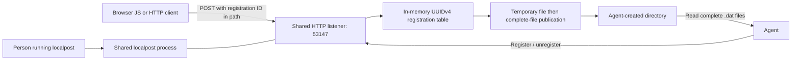

# High-level architecture

**Status:** one-listener architecture. The executable, UUID-addressed mailbox
registration, message delivery, unregistration, and browser CORS are implemented.
Bounded robustness qualification accompanies the core. A headless Chrome pilot
has also exercised the browser-to-file diagnostic feedback loop on Windows.
Accepted decisions are recorded in the [ADR ledger](adr/README.md).

## Implementation language

Implement the daemon in **Go**, with a standard-library-first approach and a
standalone executable per supported target. [ADR 0006](adr/0006-go-implementation-language.md)
records the choice over Rust and its maintenance tradeoffs. Development uses
Go 1.27.3; release targets, packaging, and any future dependencies remain open.

Go's HTTP and filesystem APIs provide building blocks, not proof of the delivery
contract. In particular, atomic publication without overwriting another delivery
must be verified on each supported OS; `os.Rename` alone is not a portable
guarantee. Concurrency and shutdown still require explicit ownership and tests.

## Components and boundaries



The diagram shows one registration. Each UUIDv4 maps to one existing absolute
directory and its logical request-lifecycle state. The shared API creates and
removes these mappings; registrations own no HTTP server or listening port.

The listener binds to `127.0.0.1` and uses plain HTTP. The default port is `53147`;
`--port` changes it. Startup binds the actual unprivileged port before announcing
readiness. [ADR 0007](adr/0007-single-port-uuid-routing.md) records the cutover
from the per-registration-port prototype.

There is no daemon configuration file, persistent registry, or separate database.
Active requests, the listener, and registrations necessarily have in-memory state;
"stateless" here means none of that state is recovered after process restart.
Delivered files belong to the agent and survive independently of the daemon.

## Registration

1. The agent creates its destination directory and arranges write permissions.
2. It sends an admin request containing the absolute directory path.
3. localpost checks that the path is an existing usable directory. It does not
   create missing parents, alter permissions, or choose a replacement directory.
4. localpost creates a UUIDv4 registration and records its directory mapping.
5. The API returns `200` with the registration ID. It allocates no new listener.

A failed registration leaves no active mailbox. Registration-time checking does
not guarantee later writes: the directory can disappear or become unwritable.
Each delivery must report its actual outcome.

The implemented registration route is `POST /registrations`, with a JSON object
containing `directory`. It returns HTTP `200` with `id`. Application errors use a
JSON `error` object with stable
`code` and readable `message`. The control API is JSON; message bodies stay opaque.
The registration identity is an opaque value for callers.

The control request is bounded to 64 KiB, with a 30-second read
budget. This does not impose a deadline on filesystem operations. Directory
validation creates, closes, and removes a temporary probe before accepting the
registration; it never creates the directory or alters permissions.

## Receiving and publishing a message

One completed `POST /registrations/{id}/messages` body is one message. The accepted
media types are `application/octet-stream` and `application/json`, including
media-type parameters. Both types use the same opaque-byte pipeline.

1. Check HTTP framing and the accepted media type without interpreting the body.
2. Receive the body with a 10 MiB limit and a 30-second stalled-upload timeout.
3. Write the body bytes to a temporary file in the registration's directory.
4. Close the complete file and publish a same-directory hard link named
   `localpost_[UUIDv7].dat`, without overwriting another delivery. Remove the
   temporary name on a best-effort basis after publication.
5. Return `200` containing the final filename and received byte count.

There is no text conversion, JSON parsing, automatic content decompression,
newline insertion, diagnostic envelope, or sidecar metadata in the final payload.
HTTP headers and transfer framing are not part of the saved body. Empty bodies
produce zero-byte files. Metadata needed by a consumer belongs in the sender's
payload or the HTTP response, not injected into the stored content.

Malformed, oversized, timed-out, disconnected, or failed writes must not publish
a partial `.dat` file or return success. Temporary-file cleanup is best effort;
a crash can leave temporary files. Agents ignore temporary names. Upload staging
names use the `.localpost-upload-` prefix; the README records the error mapping.

UUIDv7 generation uses Go's standard `uuid` package. Publication requires a
hard-link-capable filesystem. An unsupported link operation fails explicitly;
there is no copy-to-final fallback that could expose partial contents. A final
name can be read only after the underlying file is complete and closed.

The mailbox read deadline is renewed while bytes arrive, rather than applying
the control API's absolute 30-second read limit to the whole upload. It does not
bound filesystem operation duration. The final response is JSON with `filename`
and `bytes`; the message itself is never wrapped in a JSON envelope.

## Completion and uncertainty

A success response means a complete final file was published. It does not promise
power-loss durability. There is no durable queue, automatic retry, deduplication,
or replay service. If publication succeeds but the response is lost, the sender
cannot infer that delivery failed. Retrying can produce another file.

Concurrent uploads can complete in a different order from their arrival.
UUIDv7 filenames identify deliveries; they are not a substitute for an
application-level sequence. Senders include their own ordering or correlation
fields when needed. Consumers reconcile final files instead of assuming every
filesystem notification represents exactly one new message.

## Browser interoperability

The shared API responds to CORS preflights and includes CORS headers on success and
error responses. The agreed policy is:

```http
Access-Control-Allow-Origin: *
Access-Control-Allow-Methods: POST, DELETE, OPTIONS
Access-Control-Allow-Headers: Content-Type
```

`OPTIONS` does not produce a delivery file. The service has no authentication,
credential requirement, or origin allowlist. Control and message routes use the
same permissive origin policy.

Different localhost ports are different browser origins. CORS enables that
cross-origin exchange, but it does not override the sending application's CSP or
browser local-network permissions. An application may need to allow its mailbox
endpoint or forward through a thin development route. Such a route forwards
bytes to localpost; file publication remains centralized here.

## Unregistration and process lifecycle

`DELETE /registrations/{id}` stops accepting new uploads on that registration,
allows accepted uploads to finish within a 30-second grace period, then removes
the mapping. It does not close the shared listener. Remaining incomplete uploads
are aborted without publishing final files. Upload progress does not extend that deadline.
Concurrent callers share the active stop operation; a later request for a removed
registration returns `404` with `registration_not_found`.

The success response is JSON with `id`, `unregistered: true`, and a `forced`
Boolean indicating whether the grace deadline required interruption. Cleanup
continues if the caller disconnects. Whole-process shutdown freezes registration
and drains mailboxes together under one network deadline. Completion waits for
local handler cleanup; operating-system filesystem calls are not covered by a
hard real-time deadline.

Forced interruption is bound to the admitted request's lifetime. Finished
requests remove their interruption hooks before the connection can be reused,
so an old registration cannot abort a later request for a different one.

Unregistration does not delete completed files. A normal process stop likewise
closes the listener with bounded network cleanup. A crash loses every registration;
there is no restart recovery. Agents register again after a person restarts the
daemon. Agents do not start it automatically or create a substitute collector.

An occupied shared port fails startup clearly. Bind failures, directory failures,
and write failures are surfaced rather than silently changing the requested
destination or port.

## Trust and resource boundaries

Localhost callers are deliberately trusted. Localpost is not a sandbox against
other local programs or webpages. It has no TLS, tokens, origin allowlists, or
application-level payload screening. The process runs with the ordinary user's
filesystem permissions and does not elevate itself.

Limits protect process operation without changing that trust model. The fixed
defaults allow 64 live registrations and 16 globally admitted uploads, each
bounded by 10 MiB. Closing registrations count until final cleanup; upload
capacity is held through publication and the cleanup attempt. Refusal is an
immediate JSON `503` with `registration_limit` or `upload_limit`, not a queue.

The resulting 160 MiB active-payload bound excludes retained deliveries, failed
temporary cleanup, and other process memory. Progress may continue beyond one
idle interval; admission capacity still applies. Localpost never removes
delivered files to recover space. Disk exhaustion is a delivery failure.

## First implementation verification

The implementation should establish these properties before release:

- Startup reports readiness only after the shared listener is bound.
- UUIDv4 routing keeps destinations separate; failed registration leaves no mapping.
- Binary, JSON-labelled, and empty bodies are reproduced byte for byte.
- Readers see complete final files; interrupted uploads publish no partial delivery.
- Limit, timeout, disk-failure, and directory-loss cases cannot report false success.
- CORS preflights and error responses work from an actual browser; preflights write no files.
- Unregistration and process stop are bounded and preserve completed deliveries.
- Restart restores no registrations; the listener stays unprivileged and loopback-only.

Go is selected by ADR 0006. The core has executable HTTP integration and bounded
concurrency qualification tests, plus a Linux race-instrumented CI run. Packaging
and release-platform scope remain later work. The
[browser pilot](../examples/browser-diagnostics/README.md) records its verified
headless Chrome workflow; it does not establish cross-browser coverage.
First-release targets and artifact/publication rules are proposed in
[ADR 0008](adr/0008-first-release-scope.md); release qualification is still pending.
