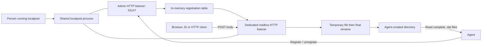

# High-level architecture

**Status:** target architecture. The executable, admin listener, and mailbox
registration are implemented; message delivery and unregistration remain unimplemented.
Accepted decisions are recorded in the [ADR ledger](adr/README.md).

## Implementation language

Implement the daemon in **Go**, with a standard-library-first approach and a
standalone executable per supported target. [ADR 0006](adr/0006-go-implementation-language.md)
records the choice over Rust and its maintenance tradeoffs. Development uses
Go 1.27.3; release targets, packaging, and any future dependencies remain open.

Go's HTTP and filesystem APIs provide building blocks, not proof of the delivery
contract. In particular, atomic publication without overwriting another delivery
must be verified on each supported OS; `os.Rename` alone is not a portable
guarantee. Concurrency and shutdown still require explicit ownership and tests.

## Components and boundaries



The diagram shows one registration. A single process can host several mailbox
listeners. Each registration maps an identity and listening port to one existing
absolute directory. The admin API creates and removes these mappings.

All listeners bind to `127.0.0.1` and use plain HTTP. The default admin port is
`53147`; `--port` changes it. Mailbox ports are allocated from available
unprivileged ports. Port allocation must bind the actual listener before reporting
success, rather than probe a free port and try to claim it later.

There is no daemon configuration file, persistent registry, or separate database.
Active requests, listeners, and registrations necessarily have in-memory state;
"stateless" here means none of that state is recovered after process restart.
Delivered files belong to the agent and survive independently of the daemon.

## Registration

1. The agent creates its destination directory and arranges write permissions.
2. It sends an admin request containing the absolute directory path.
3. localpost checks that the path is an existing usable directory. It does not
   create missing parents, alter permissions, or choose a replacement directory.
4. localpost opens a dedicated mailbox listener and records its directory mapping.
5. Only after the listener is ready does the admin API return `200`, with the
   registration identity and assigned port.

A failed registration leaves no active mailbox. Registration-time checking does
not guarantee later writes: the directory can disappear or become unwritable.
Each delivery must report its actual outcome.

The implemented registration route is `POST /registrations`, with a JSON object
containing `directory`. It returns HTTP `200` with `id` and `port` after binding
the mailbox listener. Application errors use a JSON `error` object with stable
`code` and readable `message`. The control API is JSON; message bodies stay opaque.
The registration identity is an opaque value for callers.

The admin request is bounded to 64 KiB, with a 30-second headers-and-body read
budget. This does not impose a deadline on filesystem operations. Directory
validation creates, closes,
and removes a temporary probe before accepting the registration; it never
creates the directory or alters permissions. Future admin routes and the message
upload path remain to be selected by their implementation stories.

## Receiving and publishing a message

One completed HTTP POST body is one message. The initial accepted media types
are `application/octet-stream` and `application/json`. Media-type parameter
handling remains to be specified. Both types use the same opaque-byte pipeline.

1. Check HTTP framing and the accepted media type without interpreting the body.
2. Receive the body with a 10 MiB limit and a 30-second stalled-upload timeout.
3. Write the body bytes to a temporary file in the registration's directory.
4. Close the complete file and publish it with a same-directory atomic rename
   to `localpost_[UUIDv7].dat`, without overwriting another delivery.
5. Return `200` containing the final filename and received byte count.

There is no text conversion, JSON parsing, automatic content decompression,
newline insertion, diagnostic envelope, or sidecar metadata in the final payload.
HTTP headers and transfer framing are not part of the saved body. Empty bodies
produce zero-byte files. Metadata needed by a consumer belongs in the sender's
payload or the HTTP response, not injected into the stored content.

Malformed, oversized, timed-out, disconnected, or failed writes must not publish
a partial `.dat` file or return success. Temporary-file cleanup is best effort;
a crash can leave temporary files. Agents ignore temporary names. The exact
temporary naming convention and error status mapping are still open.

## Completion and uncertainty

A success response means a complete final file was published. It does not promise
power-loss durability. There is no durable queue, automatic retry, deduplication,
or replay service. If publication succeeds but the response is lost, the sender
cannot infer that delivery failed. Retrying can produce another file.

Concurrent uploads can complete in a different order from their arrival.
UUIDv7 filenames identify deliveries; they are not a substitute for an
application-level sequence. Senders include their own ordering or correlation
fields when needed. Consumers reconcile final files instead of assuming every
filesystem notification represents exactly one new message.

## Browser interoperability

The mailbox responds to CORS preflights and includes CORS headers on success and
error responses. The agreed policy is:

```http
Access-Control-Allow-Origin: *
Access-Control-Allow-Methods: POST, OPTIONS
Access-Control-Allow-Headers: Content-Type
```

`OPTIONS` does not produce a delivery file. The service has no authentication,
credential requirement, or origin allowlist. Admin CORS follows the same
permissive origin policy; its method list will match the finalized admin routes.

Different localhost ports are different browser origins. CORS enables that
cross-origin exchange, but it does not override the sending application's CSP or
browser local-network permissions. An application may need to allow its mailbox
endpoint or forward through a thin development route. Such a route forwards
bytes to localpost; file publication remains centralized here.

## Unregistration and process lifecycle

Unregistration stops accepting new uploads on that registration, allows already
accepted uploads to finish within a bounded shutdown window, then closes the
listener and removes the mapping. Any remaining incomplete upload is aborted
without publishing a final file. The shutdown deadline will be at most 30 seconds;
its precise interaction with the stalled-upload timer remains to be specified.

Unregistration does not delete completed files. A normal process stop should
likewise close listeners with bounded cleanup. A crash loses every registration;
there is no restart recovery. Agents register again after a person restarts the
daemon. Agents do not start it automatically or create a substitute collector.

An occupied admin port fails startup clearly. Bind failures, directory failures,
and write failures are surfaced rather than silently changing the requested
destination or port.

## Trust and resource boundaries

Localhost callers are deliberately trusted. Localpost is not a sandbox against
other local programs or webpages. It has no TLS, tokens, origin allowlists, or
application-level payload screening. The process runs with the ordinary user's
filesystem permissions and does not elevate itself.

Limits protect process operation without changing that trust model. The body
limit and idle timeout are agreed; total registrations, concurrent uploads,
aggregate temporary storage, and handling of slow-but-active uploads still need
explicit implementation limits. Localpost never removes delivered files to
recover space. Disk exhaustion is a delivery failure.

## First implementation verification

The implementation should establish these properties before release:

- Registration only reports success after a real mailbox listener is ready.
- Multiple mailboxes keep destinations separate; failed registration leaks no port.
- Binary, JSON-labelled, and empty bodies are reproduced byte for byte.
- Readers see complete final files; interrupted uploads publish no partial delivery.
- Limit, timeout, disk-failure, and directory-loss cases cannot report false success.
- CORS preflights and error responses work from an actual browser; preflights write no files.
- Unregistration and process stop are bounded and preserve completed deliveries.
- Restart restores no registrations; ports remain unprivileged and loopback-only.

Go is selected by ADR 0006. Packaging, platform support, full HTTP conformance,
and the concrete test harness remain open implementation decisions.
